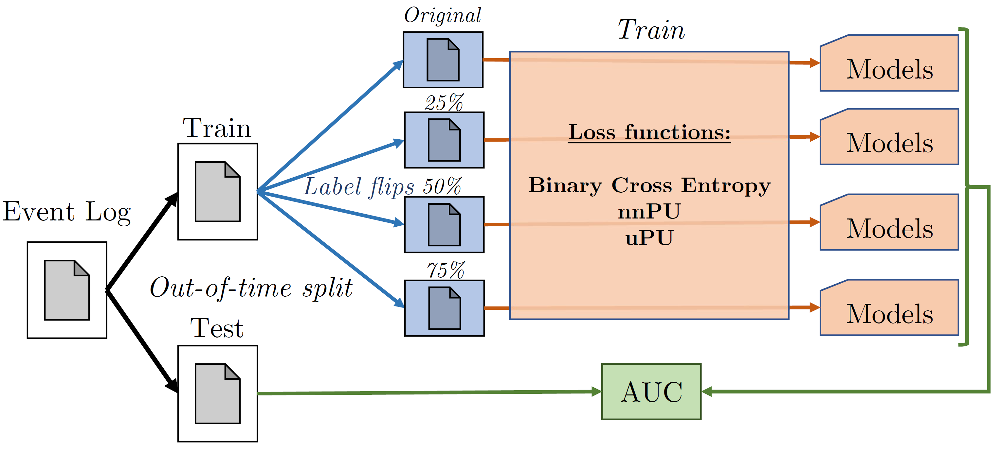

Historical data does not always tell us the outcome of every case: some fraud, for example, may never be detected. Positive and unlabelled learning helps train prediction models when only some cases have a confirmed label.

## Outcome-Oriented Predictive Process Monitoring on Positive and Unlabelled Event Logs

*ML4PM, ICPM 2022.*

We study the harm caused by treating every unlabelled case as a negative example. Adjusting the training objective for positive and unlabelled data helps reduce this problem in process outcome prediction.

[Paper](https://doi.org/10.1007/978-3-031-27815-0_19) · [Code](https://github.com/jaripeeperkorn/PU-OOPPM)

[All research topics](/research/)
