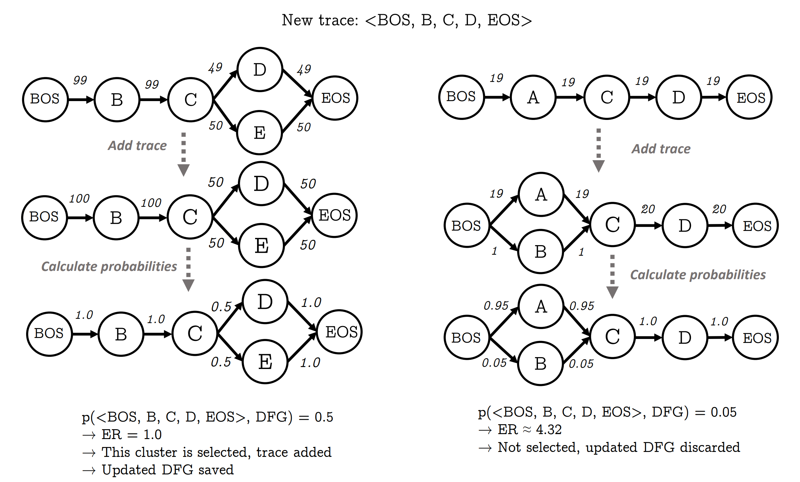

Complex processes often contain groups of cases that follow different patterns. Trace clustering separates these groups so that each can be described by a simpler process model.

## Model-driven stochastic trace clustering

*Information Systems, 2026.*

We group process executions using models that capture both the order of activities and how likely different paths are. This makes the resulting clusters reflect frequent behaviour as well as structural similarity.

[Paper](https://doi.org/10.1016/j.is.2026.102697) · [Preprint](https://arxiv.org/abs/2506.23776) · [Code](https://github.com/jaripeeperkorn/EntropicClustering)

[All research topics](/research/)
