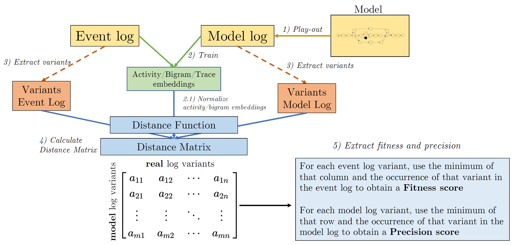
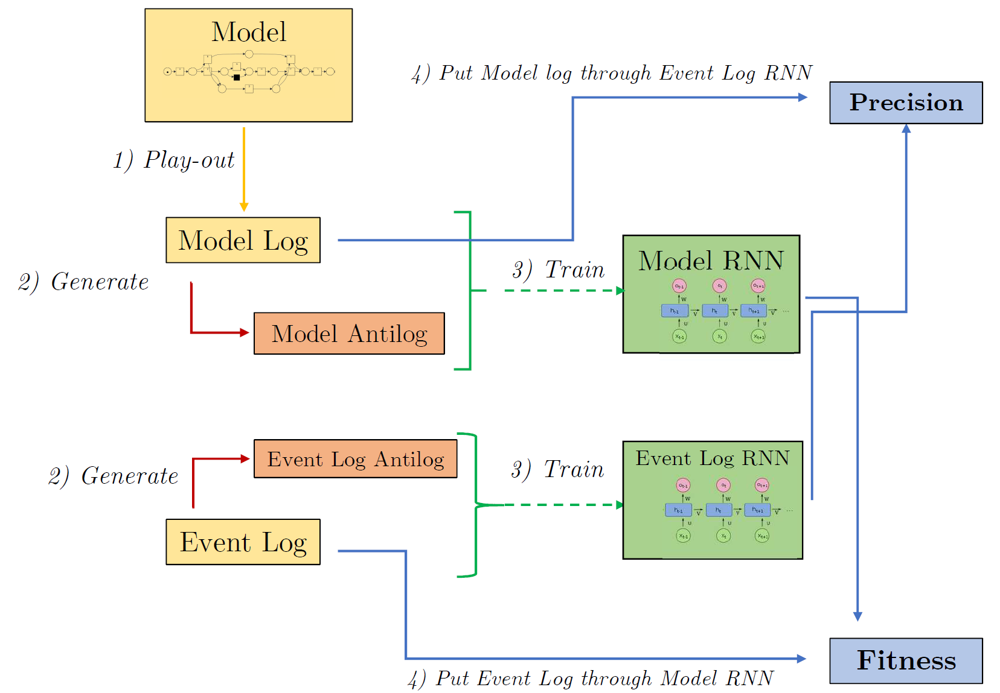

Conformance checking asks whether a process model matches what actually happens. My work uses machine learning to compare recorded behaviour with the behaviour allowed by a model.

## Global conformance checking measures using shallow representation and deep learning

*Engineering Applications of Artificial Intelligence, 2023.*

We develop and evaluate two ways to measure this match: comparing learned representations of process executions, and training neural networks to distinguish observed behaviour from artificial examples.

[Paper](https://doi.org/10.1016/j.engappai.2023.106393) · [Code](https://github.com/jaripeeperkorn/ML_Conformance)

## Supervised Conformance Checking Using Recurrent Neural Network Classifiers

*ML4PM, ICPM 2020.*

We train a recurrent neural network to distinguish process behaviour from artificially generated sequences. Its predictions provide measures of how much the event log and process model agree.

[Paper](https://doi.org/10.1007/978-3-030-72693-5_14)

## Conformance Checking Using Activity and Trace Embeddings

*BPM Forum 2020.*

We represent activities and complete process executions as numerical vectors. Distances between these representations help measure how closely a process model fits an event log.

[Paper](https://doi.org/10.1007/978-3-030-58638-6_7)

## Illustrations

[All research topics](/research/)
