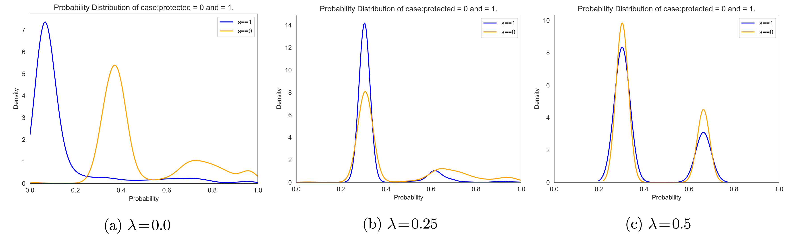
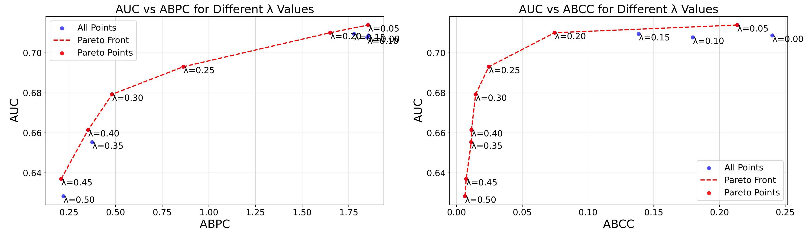

Prediction models can reproduce biases in historical process data. My work studies how to measure differences between groups and reduce them when training models for predictive process monitoring.

## Achieving Group Fairness through Independence in Predictive Process Monitoring

*CAiSE 2025.*

We compare ways to measure whether predictions depend on sensitive group membership. A training objective combines prediction accuracy with a fairness measure, allowing the trade-off between the two to be adjusted.

[Paper](https://doi.org/10.1007/978-3-031-94569-4_11) · [Code](https://github.com/jaripeeperkorn/Group-Fairness-in-Predictive-Process-Monitoring)

[All research topics](/research/)
