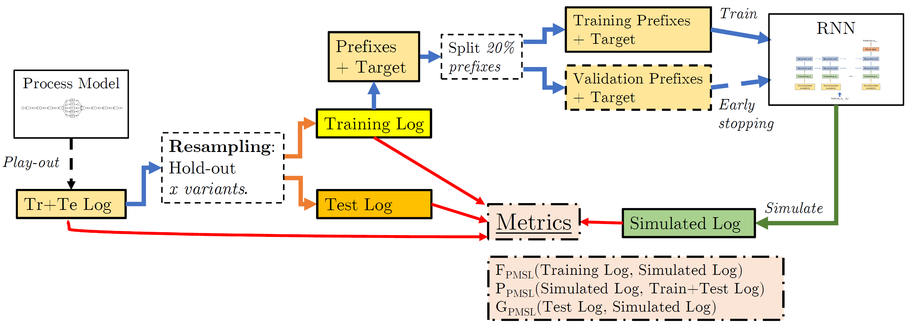

A useful prediction model should handle valid process behaviour it has not seen before. I study whether models learn the underlying process, how to test this understanding, and how to choose better training settings.

## Validation Set Sampling Strategies for Predictive Process Monitoring

*Information Systems, 2024.*

We select validation data by process variants, so model selection tests behaviour beyond the training examples. This improves how training settings and stopping points are chosen for generalization.

[Paper](https://doi.org/10.1016/j.is.2023.102330) · [Code](https://github.com/jaripeeperkorn/ValidationSelection)

## Can recurrent neural networks learn process model structure?

*Journal of Intelligent Information Systems, first published online in 2022.*

We investigate when recurrent neural networks learn the underlying process rather than reproduce familiar examples. The study examines overfitting, incomplete event logs, and different process structures.

[Paper](https://doi.org/10.1007/s10844-022-00765-x) · [Code](https://github.com/jaripeeperkorn/LSTM_Process_Model_Structure)

## Can deep neural networks learn process model structure? An assessment framework and analysis

*ML4PM, ICPM 2021.*

We introduce an evaluation framework for testing whether neural networks learn process behaviour, including unseen valid executions. Experiments on simple process models show why prediction accuracy alone gives an incomplete picture.

[Paper](https://doi.org/10.1007/978-3-030-98581-3_10)

## Novel Conformance Checking Methods and Validation Strategies for Deep Learning in Process Mining

*Doctoral booklet, KU Leuven, 2023.*

My dissertation brings together machine-learning methods for conformance checking and ways to evaluate and improve generalization in predictive process monitoring.

[Publication details](/publications/#doctoral-booklet)

For work on incorporating process knowledge into model training, see [Neurosymbolic](/neurosymbolic/).

[All research topics](/research/)
