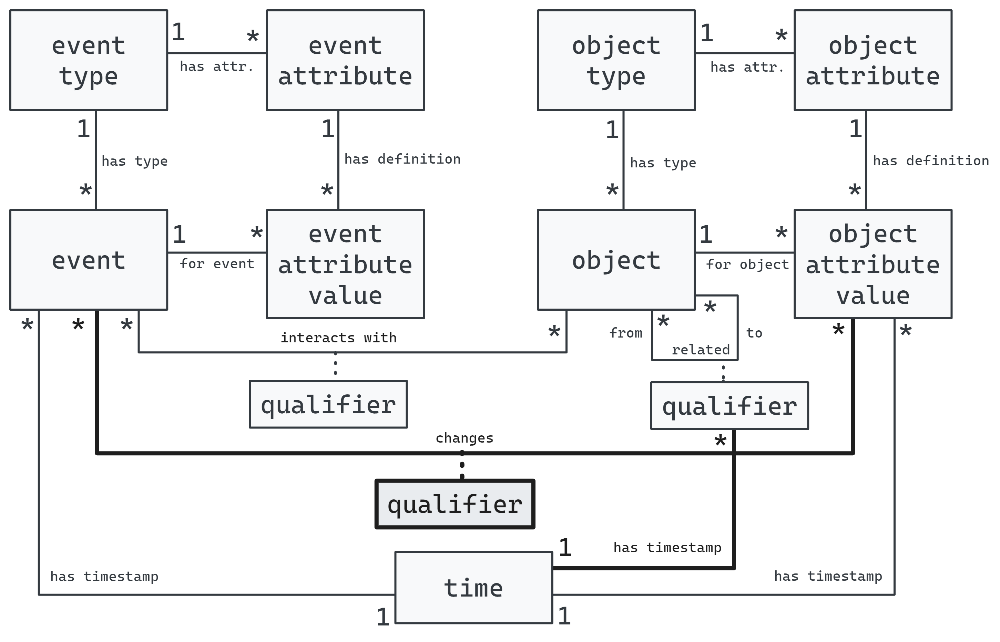
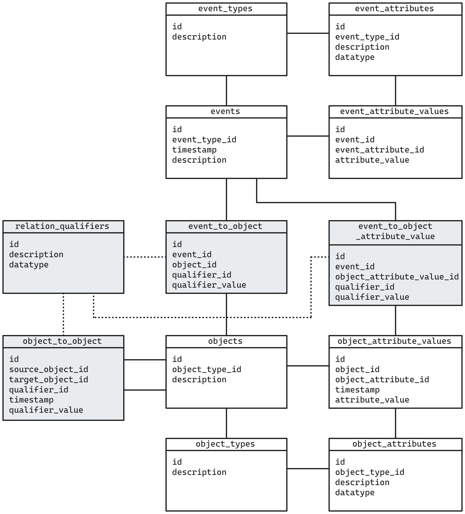

A single business event can involve several connected objects, such as an order, an item, and an invoice. Object-centric process mining keeps those connections. My work covers preparing this data and using it to discover process models.

## PyStack't: Real-Life Data for Object-Centric Process Mining

*BPM 2025 Demonstration and Resources Forum.*

PyStack't turns activity from public GitHub repositories into object-centric event data. The Python package supports export to common formats, summary statistics, and interactive exploration.

[Paper](https://ceur-ws.org/Vol-4032/paper-28.pdf)

## Dynamic and Scalable Data Preparation for Object-Centric Process Mining

*Preprint, 2024.*

We introduce Stack't, a database design and open-source data pipeline for preparing object-centric process data. It supports ongoing data collection and changing object types while connecting source systems to analysis tools.

[Paper](https://arxiv.org/abs/2410.00596) · [Code](https://github.com/LienBosmans/stack-t)

## Towards a Simple and Extensible Standard for Object-Centric Event Data (OCED) -- Core Model, Design Space, and Lessons Learned

*Preprint, 2024.*

This community report proposes a shared core model for object-centric event data. It compares design choices and implementations to guide how such data can be exchanged and extended.

[Paper](https://arxiv.org/abs/2410.14495)

## Discovering high-quality process models despite data scarcity

*ER Forum 2023.*

We study how object-centric event logs preserve information about concurrent activities, allowing process discovery from fewer recorded executions. An evaluation framework and a manufacturing case study compare this approach with discovery from traditional event logs.

[Paper](https://ceur-ws.org/Vol-3618/forum_paper_23.pdf)

## Data models

[All research topics](/research/)
